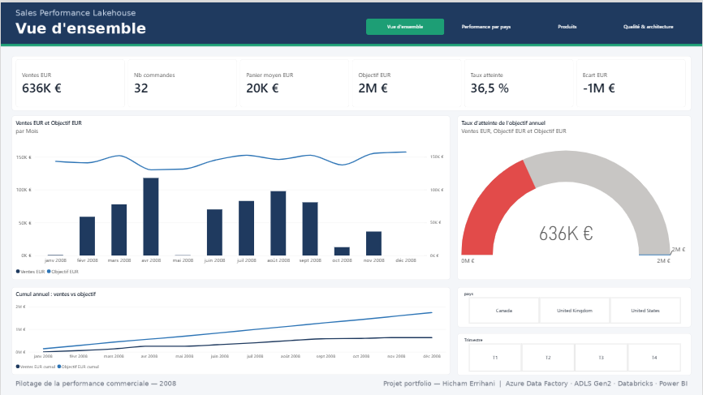
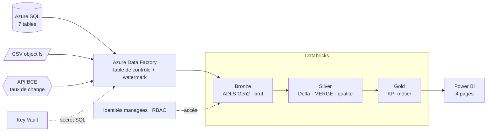
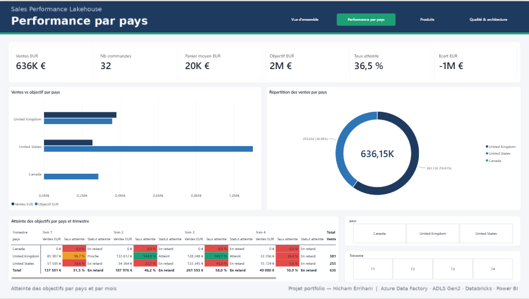
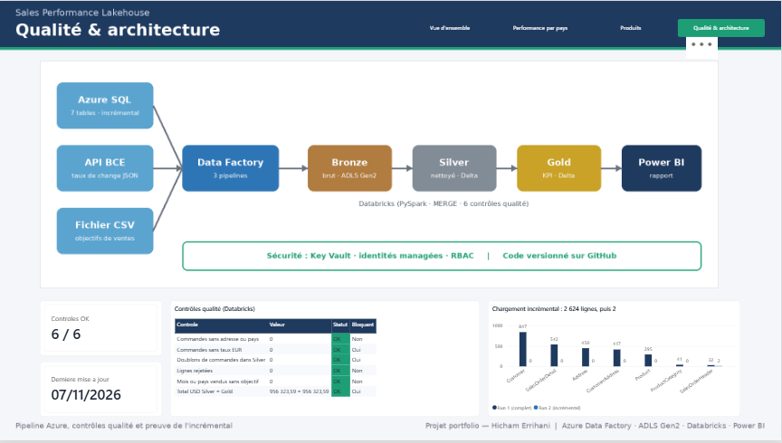

# Sales Performance Lakehouse — Azure

**Un pipeline de données de bout en bout qui répond chaque matin à une question de direction commerciale : atteignons-nous nos objectifs de ventes, par pays et par mois, en euros ?**




> Projet personnel de portfolio, conduit selon une démarche de mission client : besoin métier, livrables, contrôles qualité et documentation.
> Données : base exemple Microsoft **AdventureWorksLT** (32 commandes, 2008), taux de change **réels** de la BCE, objectifs de ventes **fictifs**.

---

## En 30 secondes

- **Problème** : ventes, objectifs et taux de change sont dans 3 sources différentes, en 2 devises.
- **Solution** : ingestion Azure Data Factory pilotée par métadonnées, architecture médaillon sur ADLS Gen2, transformations PySpark/Delta sur Databricks, rapport Power BI de 4 pages.
- **Incrémental prouvé** : 2 624 lignes au 1er chargement, puis **2 lignes** après modification de 2 commandes.
- **Fiabilité vérifiée** : 6/6 contrôles qualité OK ; total **956 323,59 USD** identique en Silver, en Gold et dans Power BI.
- **Sécurité et coût** : aucun secret dans le code (Key Vault, identités managées) ; coût d'exécution quasi nul.

---

## Le besoin métier

La direction commerciale veut un indicateur unique : **taux d'atteinte des objectifs, par pays et par mois, en EUR**.

| Source | Contenu | Format | Fréquence |
| --- | --- | --- | --- |
| Azure SQL Database | Commandes, lignes, clients, adresses, produits (7 tables) | Relationnel | Quotidienne, incrémentale |
| Contrôle de gestion | Objectifs de ventes mensuels par pays | CSV | Dépôt manuel |
| API Frankfurter (BCE) | Taux de change USD → EUR, GBP, CAD | REST / JSON | Quotidienne |

---

## Architecture



**Pipeline d'ingestion SQL piloté par métadonnées** : une seule définition charge les 7 tables. Ajouter une table = ajouter une ligne dans `etl.ControlTable`.


```
lkp_control_table → ForEach (4 tables en parallèle)
                     ├─ lkp_new_watermark   : MAX(ModifiedDate) actuel
                     ├─ cp_sql_to_bronze    : lignes entre ancien et nouveau watermark → Parquet
                     └─ sp_update_watermark : procédure stockée etl.usp_UpdateWatermark
```

---

## Résultats vérifiés

| Vérification | Résultat |
| --- | --- |
| 1er chargement SQL → Bronze | **2 624 lignes**, 7 tables, ~1 min 30 |
| 2e chargement après modification de 2 commandes | **2 lignes** (SalesOrderHeader), 0 pour les 6 autres tables |
| Ingestion API BCE et CSV | Réussies (17 s et 16 s) |
| Contrôles qualité Databricks | **6 / 6 OK**, 0 ligne rejetée |
| Total USD Silver = Gold | **956 323,59 = 956 323,59** |
| Contrôle croisé Power BI | 956 323,59 USD, **32 commandes** |

---

## Décisions d'architecture

| Décision | Alternative | Pourquoi |
| --- | --- | --- |
| Watermark sur `ModifiedDate` | Change Data Capture | Colonne fiable dans la source, solution simple et peu coûteuse. Le CDC serait requis pour capter les suppressions. |
| Table de contrôle (Lookup → ForEach) | Un pipeline par table | Une seule définition à maintenir ; l'ajout d'une table ne touche pas au code. |
| Parquet en Bronze, Delta dès Silver | Delta partout | Bronze reste une copie brute rejouable ; Delta apporte MERGE, transactions et historique là où on transforme. |
| `MERGE` Delta en Silver | Overwrite | Idempotence : relancer un traitement ne crée jamais de doublons. |
| Gold recalculée (`overwrite`) | MERGE en Gold | Tables petites, toujours cohérentes avec Silver, logique plus simple. |
| Key Vault + identités managées | Mot de passe dans le service lié | Aucun secret dans le code ni dans Git ; droits RBAC au plus juste. |
| Databricks Free Edition | Azure Databricks | Coût maîtrisé pour un portfolio. Les notebooks sont prêts pour Azure Databricks (`bronze_path` vide = lecture directe d'ADLS). |

---

## Qualité et fiabilité

| # | Contrôle | Bloquant |
| --- | --- | --- |
| 1 | Doublons de commandes dans Silver | Oui |
| 2 | Commandes sans taux EUR | Oui |
| 3 | Commandes sans adresse ou pays | Non |
| 4 | Total USD Silver = Gold | Oui |
| 5 | Mois ou pays vendus sans objectif | Non |
| 6 | Lignes rejetées dans la journée | Non |

- Les lignes invalides (clé vide, taux négatif, pays inconnu…) vont dans `ops.rejets` avec leur raison : **le pipeline continue**.
- Chaque exécution est historisée dans `ops.journal_qualite`.
- Un contrôle bloquant en échec **arrête le traitement** avant que des chiffres faux n'atteignent le rapport.
- Les taux non publiés (week-ends, jours fériés) sont complétés par le dernier taux connu : chaque commande a un taux.

---

## Problèmes rencontrés et résolus

| Symptôme | Cause | Solution |
| --- | --- | --- |
| Délai de connexion dépassé | Base Serverless en pause automatique | Réessai après réveil ; en production : politique de retry sur l'activité |
| Connexion SQL refusée | Adresse IP du poste qui change | Règles de pare-feu par plage d'adresses |
| Pipeline CSV en échec | JSON invalide (paramètre vide, `quoteAllText`) | Correction de la définition et redéploiement par commit Git |
| Notebook des taux : 0 ligne, sans erreur | BOM UTF-8 en tête du JSON écrit par Data Factory | Inspection du fichier brut, retrait du BOM avant parsing, ligne de contrôle ajoutée |
| Montants multipliés par 100 dans Power BI | Séparateur décimal mal interprété | Paramètres régionaux d'import en Anglais (États-Unis) |
| CA par catégorie ≠ CA total | `LineTotal` (hors taxes et port) vs `TotalDue` (facturé) | Définition de chaque indicateur documentée dans le rapport |

---

## Rapport Power BI

| Page | Contenu |
| --- | --- |
| Vue d'ensemble | 6 KPI, ventes vs objectif par mois, jauge d'atteinte colorée, cumul annuel, segments |
| Performance par pays | Ventes vs objectif, répartition, matrice pays × trimestre avec statut (vert / orange / rouge) |
| Produits | Top 10 des catégories, évolution mensuelle, part et rang |
| Qualité & architecture | Schéma du pipeline, contrôles qualité, preuve de l'incrémental |

| Performance par pays | Qualité & architecture |
| --- | --- |
|  |  |

Modèle en étoile (table Calendrier) · 20 mesures DAX créées par script **TMDL** · seuils d'atteinte centralisés dans une mesure · navigation par boutons.

📄 [Rapport complet en PDF](powerbi/Sales_Performance_Lakehouse.pdf) · source : `powerbi/Sales_Performance_Lakehouse.pbix`

---

## Ce que 20 ans de données m'ont appris à exiger

- **Un chiffre doit pouvoir se prouver** : d'où le contrôle « total Silver = Gold » et le recoupement dans Power BI.
- **Une erreur silencieuse est pire qu'une erreur visible** : d'où les contrôles bloquants et la table de rejets.
- **Un indicateur doit avoir une définition écrite** : CA facturé et CA produits sont distingués et documentés.
- **La traçabilité n'est pas optionnelle** : watermark, journal qualité, chaque correction versionnée dans Git.
- Ces exigences viennent de 20 ans en environnement industriel de défense (General Dynamics Land Systems, Leonardo DRS) et institutionnel (AUF).

---

## Passage en production

| Aujourd'hui (portfolio) | En production |
| --- | --- |
| Notebooks sur Databricks Free Edition | Azure Databricks, lancé par `pl_transform_databricks` |
| Exécutions manuelles | `pl_master` (3 ingestions en parallèle puis transformation) + déclencheur quotidien 06:00 |
| Watermark | CDC si les suppressions doivent être suivies |
| Ressources créées dans le portail | Infrastructure en code (Bicep ou Terraform) |
| Branche `main` unique | CI/CD (GitHub Actions, dev/test/prod, Databricks Asset Bundles) |
| Contrôles dans le journal | Alertes Azure Monitor sur échec de pipeline ou de contrôle |

---

## Structure du dépôt

```
sql/          Table de contrôle, procédure watermark, test incrémental
data/         Objectifs mensuels par pays (fictifs)
adf/          linkedService/ dataset/ pipeline/ trigger/  (JSON, relié à Data Factory)
databricks/   00_setup, 00_common, 01 à 05 (Bronze → Silver → Gold, qualité)
powerbi/      Rapport .pbix, export PDF, captures, mesures DAX
docs/         GUIDE_ETAPES.md, images
```

**Reproduire** : voir [docs/GUIDE_ETAPES.md](docs/GUIDE_ETAPES.md).

**Coût** : Azure SQL en offre gratuite (Serverless, pause automatique), Data Factory facturé à l'exécution, stockage et Key Vault à quelques centimes, Databricks Free Edition. Coût d'exécution quasi nul.

---

## Auteur

**Hicham Errihani** — Data Engineer / BI · ~20 ans dans la donnée · Master Ingénierie Informatique et Big Data
[LinkedIn](https://www.linkedin.com/in/hicham-errihani-815755266) · [GitHub](https://github.com/HichamErrihani-Eng)

Disponible pour des postes de Data Engineer confirmé ou Data Architect et pour des missions freelance (Azure, Databricks, Power BI).

---

## English summary

End-to-end Azure data pipeline built as a portfolio project following a client-engagement approach. Three sources (Azure SQL, CSV, ECB REST API) are ingested by a metadata-driven, incremental Azure Data Factory pipeline into ADLS Gen2, then transformed with PySpark and Delta Lake (idempotent MERGE) through a Bronze/Silver/Gold architecture, secured with Key Vault and managed identities, and served in a 4-page Power BI report.

Verified results: 2,624 rows on first load, 2 rows after updating 2 orders; 6/6 data quality checks passed; USD total of 956,323.59 identical in Silver, Gold and Power BI. Data: Microsoft AdventureWorksLT sample, real ECB exchange rates, fictitious sales targets.
