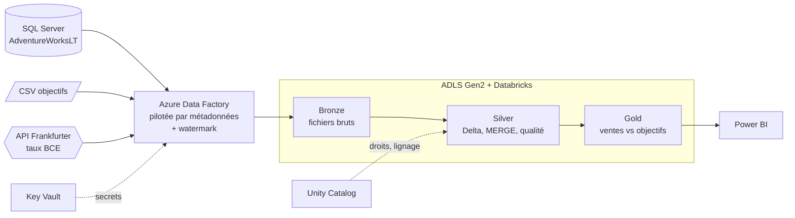

# Pipeline de ventes multi-sources sur Azure

**EN —** End-to-end Azure data pipeline: three heterogeneous sources (SQL Server, CSV, REST API) ingested by a metadata-driven, incremental Azure Data Factory pipeline into ADLS Gen2, transformed with Databricks (PySpark, Delta Lake, MERGE) through a Bronze/Silver/Gold medallion architecture, governed with Unity Catalog and Key Vault, and served in Power BI.

## Le besoin métier
Une entreprise de vente veut savoir **chaque matin** si elle atteint ses objectifs, **par pays et par mois**, dans **une seule devise (EUR)**.
Ses données sont dispersées :

| Source | Contenu | Format |
| --- | --- | --- |
| SQL Server (Azure SQL) | Commandes, clients, adresses, produits | Base relationnelle |
| Fichiers déposés par le contrôle de gestion | Objectifs de ventes par mois et par pays | CSV |
| API Frankfurter (taux BCE) | Taux de change quotidiens USD → EUR | REST / JSON |

> Données : base d'exemple Microsoft **AdventureWorksLT** ; objectifs **fictifs** générés pour la démonstration (`data/objectifs_ventes_2008.csv`) ; taux de change **réels** de la BCE.

## Architecture



## Ce que montre ce projet

| Compétence | Mise en œuvre |
| --- | --- |
| Intégration de sources hétérogènes | SQL, CSV et API REST dans le même modèle |
| Industrialisation | **Un seul pipeline** piloté par la table `etl.ControlTable` (Lookup → ForEach → Copy) |
| Chargement incrémental | Watermark sur `ModifiedDate`, mis à jour par procédure stockée |
| Idempotence | `MERGE` Delta en Silver : relancer ne crée jamais de doublons |
| Qualité des données | Règles par source, table `ops.rejets`, journal `ops.journal_qualite`, contrôles bloquants |
| Gestion des taux manquants | Calendrier complet + report du dernier taux connu (week-ends, jours fériés) |
| Sécurité et gouvernance | Mot de passe SQL dans Key Vault, identités managées, Unity Catalog |
| Orchestration | `pl_master` : 3 ingestions en parallèle puis Databricks, déclencheur quotidien |
| Restitution | Power BI : ventes, objectifs, taux d'atteinte, catégories |

## Structure du dépôt

```
sql/
  01_control_table.sql            Table de contrôle (métadonnées + watermark)
  02_update_watermark_proc.sql    Procédure de mise à jour du watermark
  03_test_incremental.sql         Test : modifier 2 commandes et relancer
  04_optionnel_etaler_dates_2008.sql  Répartir les commandes sur 2008 (démo)
data/
  objectifs_ventes_2008.csv       Objectifs mensuels par pays (fictifs)
adf/
  linkedService/  dataset/  pipeline/  trigger/   Définitions JSON Data Factory
databricks/
  00_setup.py  00_common.py
  01_bronze_to_silver_sql.py      7 tables SQL → Silver (MERGE)
  02_bronze_to_silver_objectifs.py
  03_bronze_to_silver_fx.py       JSON API → taux quotidiens complets
  04_silver_to_gold.py            ventes_vs_objectifs, ventes_par_categorie
  05_quality_checks.py            Contrôles, journal, échec si bloquant
powerbi/
  mesures_dax.md
docs/
  GUIDE_ETAPES.md                 Déploiement pas à pas
```

## Modèle Gold

`gold.ventes_vs_objectifs` — grain : **un mois × un pays**

| Colonne | Description |
| --- | --- |
| mois | AAAA-MM |
| pays | Pays de livraison |
| nb_commandes | Nombre de commandes |
| ventes_usd / ventes_eur | Montant TTC, converti au taux BCE du jour de la commande |
| objectif_eur | Objectif du contrôle de gestion |
| taux_atteinte | ventes_eur / objectif_eur |
| ecart_eur | ventes_eur − objectif_eur |

`gold.ventes_par_categorie` — grain : **un mois × une catégorie de produit**.

## Choix techniques
- **Watermark plutôt que CDC** : la source a une colonne `ModifiedDate` fiable, c'est la solution la plus simple. Pour les suppressions, il faudrait le Change Data Capture.
- **Parquet en Bronze, Delta à partir de Silver** : Bronze est une copie brute ; Delta apporte MERGE, historique et transactions.
- **Gold recalculée (`overwrite`)** : tables petites, toujours cohérentes avec Silver.
- **Report du dernier taux connu** : la BCE ne publie pas le week-end ; sans cela, des commandes resteraient sans conversion.

## Améliorations prévues
- Auto Loader pour l'ingestion des fichiers en Bronze.
- Déploiement CI/CD (Git Azure DevOps ou GitHub Actions, environnements dev/test/prod, Databricks Asset Bundles).
- Infrastructure en code (Bicep ou Terraform).
- Alertes Azure Monitor sur les échecs de `pl_master`.

## Démarrer
Voir **[docs/GUIDE_ETAPES.md](docs/GUIDE_ETAPES.md)**.

## Coût
Base Azure SQL *Basic*, stockage, Data Factory à l'usage et un cluster Databricks à arrêt automatique : quelques dollars par jour d'utilisation. Supprimer le groupe de ressources à la fin.

---
Auteur : Hicham Errihani — [LinkedIn](https://www.linkedin.com/in/hicham-errihani-815755266) · [GitHub](https://github.com/Hicham-Errihani)
